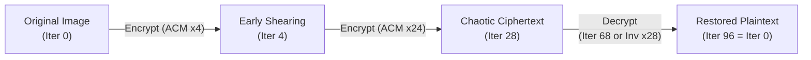

# Arnold's Cat Map Algorithm in Digital Image Encryption

A comprehensive technical walkthrough of Arnold's Cat Map (ACM) based on the research paper:

> **Paper Reference:**  
> Eko Hariyanto and Robbi Rahim, *"Arnold's Cat Map Algorithm in Digital Image Encryption"*, International Journal of Science and Research (IJSR), Volume 5, Issue 10, October 2016, pp. 1363-1365. Paper ID: ART20162488. DOI: 10.21275/ART20162488.

---

## 1. Executive Summary and Motivation

Traditional cryptographic algorithms (such as DES, AES, Blowfish, and RSA) were developed primarily for one-dimensional textual or stream data. When applied directly to digital images, several domain-specific challenges arise:

1. **Massive Data Volume:** High-resolution digital images contain millions of bytes, requiring excessive computational throughput under traditional block ciphers.
2. **High Inter-Pixel Redundancy:** Neighboring pixels in natural images exhibit strong spatial correlation (adjacent pixels often have nearly identical intensity values).
3. **Real-Time Latency Demands:** Applications such as video streaming, live teleconferencing, and broadcast media demand lightweight, deterministic, and fast encryption mechanisms.

Arnold's Cat Map (ACM) is a two-dimensional chaotic bijection used as a spatial permutation cipher. By iteratively shuffling pixel coordinates across a discrete lattice, ACM disperses spatial correlations and renders the visual representation pseudo-random, while preserving all original pixel values without data loss.

---

## 2. Mathematical Formulation

### 2.1 Classical Continuous Formulation
Introduced by mathematician Vladimir Arnold in the 1960s, the continuous Arnold's Cat Map is a chaotic automorphism of the 2-torus $\mathbb{T}^2 = \mathbb{R}^2 / \mathbb{Z}^2$:

$$\begin{bmatrix} x' \\ y' \end{bmatrix} = \begin{bmatrix} 1 & 1 \\ 1 & 2 \end{bmatrix} \begin{bmatrix} x \\ y \end{bmatrix} \pmod 1$$

The transformation stretches and shears the unit square along the eigenvectors of the matrix and folds it back via modulo arithmetic, producing deterministic chaos.

### 2.2 Generalized Discrete 2D Cat Map
For digital images, the continuous domain is mapped onto a finite discrete grid of size $N \times N$, defined by coordinate set:

$$S = \left\{ (x, y) \mid x, y \in \{0, 1, 2, \dots, N-1\} \right\}$$

The generalized discrete Arnold's Cat Map transformation is defined as:

$$\begin{bmatrix} x' \\ y' \end{bmatrix} = A \begin{bmatrix} x \\ y \end{bmatrix} \pmod N = \begin{bmatrix} 1 & p \\ q & pq + 1 \end{bmatrix} \begin{bmatrix} x \\ y \end{bmatrix} \pmod N$$

Where:
- $(x, y)$ is the original pixel coordinate (horizontal and vertical indices).
- $(x', y')$ is the transformed pixel coordinate.
- $N$ is the linear dimension of the square image block ($N \times N$).
- $p$ and $q$ are positive integers serving as control parameters (secret keys).

### 2.3 Determinant and Bijectivity
The determinant of transformation matrix $A$ is:

$$\det(A) = 1 \cdot (pq + 1) - p \cdot q = pq + 1 - pq = 1$$

Because $\det(A) = 1 \neq 0$ and $\gcd(\det(A), N) = 1$ for any positive integer $N$, matrix $A$ is invertible in the modular arithmetic ring $\mathbb{Z}_N$. This guarantees:
- **Bijectivity:** The mapping is one-to-one (injective) and onto (surjective). No two coordinates collide, and every grid location is filled.
- **Area Preservation:** The number of pixels and the global intensity distribution (histogram) remain invariant.

### 2.4 Decryption Mechanisms

There are two distinct mathematical methods to decrypt an image encrypted with Arnold's Cat Map:

#### Method 1: Direct Algebraic Inverse
Because $\det(A) = 1$, the algebraic inverse matrix $A^{-1}$ modulo $N$ is:

$$A^{-1} = \begin{bmatrix} pq + 1 & -p \\ -q & 1 \end{bmatrix} \pmod N$$

In modular arithmetic, negative entries are adjusted into $[0, N-1]$ via:

$$-p \equiv (N - (p \pmod N)) \pmod N$$
$$-q \equiv (N - (q \pmod N)) \pmod N$$

Decryption maps each transformed coordinate $(x', y')$ back to its original coordinate $(x, y)$:

$$\begin{bmatrix} x \\ y \end{bmatrix} = A^{-1} \begin{bmatrix} x' \\ y' \end{bmatrix} \pmod N$$

#### Method 2: Periodicity (Poincaré Recurrence)
Because the discrete grid $S$ has a finite number of points ($N^2$), the set of possible permutations is finite. Consequently, repeated applications of $A$ form a finite cyclic group:

$$A^T \equiv I \pmod N$$

Where:
- $I$ is the $2 \times 2$ identity matrix.
- $T = T(N, p, q)$ is the minimal positive integer known as the **Arnold period**.

If an image is encrypted with $R$ iterations, it can be decrypted by continuing forward for $T - R$ iterations:

$$A^{T - R} \left( A^R (I) \right) = A^T (I) = I$$

---

## 3. Handling Non-Square Image Dimensions

A fundamental property of Arnold's Cat Map is that the modulo base $N$ operates symmetrically across both $x$ and $y$ coordinates, requiring a square grid ($N \times N$).

In Section 3 of the paper, the authors evaluate a non-square test image of size $200 \times 223$ pixels. To apply the algorithm without resizing or cropping, the paper uses block partitioning:
1. Divide the arbitrary rectangular image into smaller square sub-blocks of size $M \times M$ (specifically $4 \times 4$ pixels).
2. Apply the Arnold Cat Map transformation to each $4 \times 4$ sub-block independently.
3. Iterate across all sub-blocks until the entire image is permuted.

---

## 4. Step-by-Step Numerical Walkthrough (3x3 Pixel Block)

In Section 3 (Tables 1, 2, and 3), the paper presents a concrete numerical example using a $3 \times 3$ pixel matrix extracted from a test image via MATLAB.

### 4.1 Original Pixel Matrix (Table 2) and Channel Representation

A digital RGB color image is structurally a 3-dimensional tensor of size $H \times W \times 3$, where each pixel at coordinate $(x, y)$ consists of an intensity triplet:

$$I(x, y) = \begin{bmatrix} R(x, y), & G(x, y), & B(x, y) \end{bmatrix}$$

In Table 1 ("RGB Value") and Table 2 ("Sample 3X3 Pixel"), the paper displays single scalar integers (e.g., $104$ at position $(0,0)$). In image processing and MATLAB workflows, this occurs for one of two reasons:
1. **Single Color Plane Extraction:** The authors extracted a single 2D channel plane (such as the Red channel matrix `img(:,:,1)` or Green channel `img(:,:,2)`).
2. **Grayscale Conversion:** The image was converted to a 2D luminance matrix using a standard weighted sum (e.g., `rgb2gray`).

In both cases, each cell represents a scalar intensity in the range $[0, 255]$. 

Because Arnold's Cat Map is fundamentally a **spatial coordinate permutation** $(x, y) \mapsto (x', y')$, the underlying data payload at each location can be:
- A single 8-bit scalar (grayscale or single channel).
- A 24-bit vector $[R, G, B]$ moved synchronously as a unit.
- An entire image sub-tile (e.g., an $M \times M \times 3$ block in tile-transposition systems).

Let $N = 3$. The coordinate domain is $\{0, 1, 2\} \times \{0, 1, 2\}$, where $x$ represents the column index and $y$ represents the row index:

```text
               Column (x)
             0      1      2
Row (y)  +------+------+------+
   0     | 104  | 134  | 144  |
         +------+------+------+
   1     |  88  | 124  | 140  |
         +------+------+------+
   2     |  84  | 123  | 141  |
         +------+------+------+
```

The coordinate-to-value mapping of the original block is:
- $(x=0, y=0) \to 104$
- $(x=1, y=0) \to 134$
- $(x=2, y=0) \to 144$
- $(x=0, y=1) \to 88$
- $(x=1, y=1) \to 124$
- $(x=2, y=1) \to 140$
- $(x=0, y=2) \to 84$
- $(x=1, y=2) \to 123$
- $(x=2, y=2) \to 141$

---

### 4.2 Analysis of the Calculation in the Published Paper

In Section 3 of the paper, the authors substitute parameters into their transformation matrix:

$$\begin{bmatrix} x_{i+1} \\ y_{i+1} \end{bmatrix} = \begin{bmatrix} 1 & b \\ c & bc + 1 \end{bmatrix} \begin{bmatrix} x_i \\ y_i \end{bmatrix} \pmod n$$

For their test, the authors selected $b = 134$ (the value at pixel $(1, 0)$) and $c = 84$ (the value at pixel $(0, 2)$). In their manual walkthrough, several editorial anomalies occurred in the published text:

1. **Typographical Matrix Formulation:** The paper prints the bottom-right matrix entry as `134 + 84 + 1 = 219`, replacing the multiplication $b \cdot c$ with addition $b + c$.
2. **Intermediate Calculation Collapse:** In the printed equations on pages 1364-1365, the intermediate matrix multiplications were evaluated with arithmetic inconsistencies, resulting in target coordinates collapsing exclusively into $[0, 0]^T$ and $[2, 0]^T$.
3. **Table 3 Result:** Despite the collapsed equations, the authors reported Table 3 ("Result Arnold Cat Map") with 9 distinct pixel values, reflecting a 3-element permutation cycle where $(0,0) \to (0,2) \to (2,0) \to (0,0)$ while remaining cells were kept fixed.

To provide a mathematically rigorous, functional guide, the following subsections provide the exact step-by-step calculations under standard Arnold's Cat Map theory.

---

### 4.3 Standard Canonical Arnold's Cat Map Walkthrough ($p = 1, q = 1, N = 3$)

Under the canonical Arnold parameters $p = 1, q = 1$:

$$A = \begin{bmatrix} 1 & 1 \\ 1 & 1 \cdot 1 + 1 \end{bmatrix} = \begin{bmatrix} 1 & 1 \\ 1 & 2 \end{bmatrix}$$

$$\det(A) = (1)(2) - (1)(1) = 1$$

Modulo base $N = 3$.

#### Encryption: Coordinate-by-Coordinate Transformation

The transformation equation is:

$$\begin{bmatrix} x' \\ y' \end{bmatrix} = \begin{bmatrix} 1 & 1 \\ 1 & 2 \end{bmatrix} \begin{bmatrix} x \\ y \end{bmatrix} \pmod 3$$

Evaluating all 9 coordinates:

1. **Coordinate $(0, 0)$, Value = 104:**
   $$\begin{bmatrix} x' \\ y' \end{bmatrix} = \begin{bmatrix} 1(0) + 1(0) \\ 1(0) + 2(0) \end{bmatrix} = \begin{bmatrix} 0 \\ 0 \end{bmatrix} \pmod 3 = \begin{bmatrix} 0 \\ 0 \end{bmatrix}$$
   Pixel moves from $(0, 0) \to (0, 0)$.

2. **Coordinate $(1, 0)$, Value = 134:**
   $$\begin{bmatrix} x' \\ y' \end{bmatrix} = \begin{bmatrix} 1(1) + 1(0) \\ 1(1) + 2(0) \end{bmatrix} = \begin{bmatrix} 1 \\ 1 \end{bmatrix} \pmod 3 = \begin{bmatrix} 1 \\ 1 \end{bmatrix}$$
   Pixel moves from $(1, 0) \to (1, 1)$.

3. **Coordinate $(2, 0)$, Value = 144:**
   $$\begin{bmatrix} x' \\ y' \end{bmatrix} = \begin{bmatrix} 1(2) + 1(0) \\ 1(2) + 2(0) \end{bmatrix} = \begin{bmatrix} 2 \\ 2 \end{bmatrix} \pmod 3 = \begin{bmatrix} 2 \\ 2 \end{bmatrix}$$
   Pixel moves from $(2, 0) \to (2, 2)$.

4. **Coordinate $(0, 1)$, Value = 88:**
   $$\begin{bmatrix} x' \\ y' \end{bmatrix} = \begin{bmatrix} 1(0) + 1(1) \\ 1(0) + 2(1) \end{bmatrix} = \begin{bmatrix} 1 \\ 2 \end{bmatrix} \pmod 3 = \begin{bmatrix} 1 \\ 2 \end{bmatrix}$$
   Pixel moves from $(0, 1) \to (1, 2)$.

5. **Coordinate $(1, 1)$, Value = 124:**
   $$\begin{bmatrix} x' \\ y' \end{bmatrix} = \begin{bmatrix} 1(1) + 1(1) \\ 1(1) + 2(1) \end{bmatrix} = \begin{bmatrix} 2 \\ 3 \end{bmatrix} \pmod 3 = \begin{bmatrix} 2 \\ 0 \end{bmatrix}$$
   Pixel moves from $(1, 1) \to (2, 0)$.

6. **Coordinate $(2, 1)$, Value = 140:**
   $$\begin{bmatrix} x' \\ y' \end{bmatrix} = \begin{bmatrix} 1(2) + 1(1) \\ 1(2) + 2(1) \end{bmatrix} = \begin{bmatrix} 3 \\ 4 \end{bmatrix} \pmod 3 = \begin{bmatrix} 0 \\ 1 \end{bmatrix}$$
   Pixel moves from $(2, 1) \to (0, 1)$.

7. **Coordinate $(0, 2)$, Value = 84:**
   $$\begin{bmatrix} x' \\ y' \end{bmatrix} = \begin{bmatrix} 1(0) + 1(2) \\ 1(0) + 2(2) \end{bmatrix} = \begin{bmatrix} 2 \\ 4 \end{bmatrix} \pmod 3 = \begin{bmatrix} 2 \\ 1 \end{bmatrix}$$
   Pixel moves from $(0, 2) \to (2, 1)$.

8. **Coordinate $(1, 2)$, Value = 123:**
   $$\begin{bmatrix} x' \\ y' \end{bmatrix} = \begin{bmatrix} 1(1) + 1(2) \\ 1(1) + 2(2) \end{bmatrix} = \begin{bmatrix} 3 \\ 5 \end{bmatrix} \pmod 3 = \begin{bmatrix} 0 \\ 2 \end{bmatrix}$$
   Pixel moves from $(1, 2) \to (0, 2)$.

9. **Coordinate $(2, 2)$, Value = 141:**
   $$\begin{bmatrix} x' \\ y' \end{bmatrix} = \begin{bmatrix} 1(2) + 1(2) \\ 1(2) + 2(2) \end{bmatrix} = \begin{bmatrix} 4 \\ 6 \end{bmatrix} \pmod 3 = \begin{bmatrix} 1 \\ 0 \end{bmatrix}$$
   Pixel moves from $(2, 2) \to (1, 0)$.

#### Summary Permutation Table

| Original Coordinate $(x, y)$ | Original Pixel Value | New Coordinate $(x', y')$ | Destination in Encrypted Grid |
| :---: | :---: | :---: | :---: |
| $(0, 0)$ | 104 | $(0, 0)$ | Row 0, Col 0 |
| $(1, 0)$ | 134 | $(1, 1)$ | Row 1, Col 1 |
| $(2, 0)$ | 144 | $(2, 2)$ | Row 2, Col 2 |
| $(0, 1)$ | 88 | $(1, 2)$ | Row 2, Col 1 |
| $(1, 1)$ | 124 | $(2, 0)$ | Row 0, Col 2 |
| $(2, 1)$ | 140 | $(0, 1)$ | Row 1, Col 0 |
| $(0, 2)$ | 84 | $(2, 1)$ | Row 1, Col 2 |
| $(1, 2)$ | 123 | $(0, 2)$ | Row 2, Col 0 |
| $(2, 2)$ | 141 | $(1, 0)$ | Row 0, Col 1 |

#### Resulting Encrypted Grid (Iteration 1)

Placing each original pixel into its destination coordinate $(x', y')$:

```text
               Column (x')
             0      1      2
Row (y') +------+------+------+
   0     | 104  | 141  | 124  |
         +------+------+------+
   1     | 140  | 134  |  84  |
         +------+------+------+
   2     | 123  |  88  | 144  |
         +------+------+------+
```

Every original value is retained, but the spatial arrangement is permuted.

---

### 4.4 Decryption Walkthrough

#### Method 1: Using the Inverse Matrix

The algebraic inverse of $A = \begin{bmatrix} 1 & 1 \\ 1 & 2 \end{bmatrix}$ is:

$$A^{-1} = \begin{bmatrix} 2 & -1 \\ -1 & 1 \end{bmatrix} \pmod 3$$

Because $-1 \equiv 2 \pmod 3$:

$$A^{-1} = \begin{bmatrix} 2 & 2 \\ 2 & 1 \end{bmatrix} \pmod 3$$

Verification of inverse:

$$A \cdot A^{-1} = \begin{bmatrix} 1 & 1 \\ 1 & 2 \end{bmatrix} \begin{bmatrix} 2 & 2 \\ 2 & 1 \end{bmatrix} = \begin{bmatrix} 4 & 3 \\ 6 & 4 \end{bmatrix} \equiv \begin{bmatrix} 1 & 0 \\ 0 & 1 \end{bmatrix} \pmod 3$$

Applying $A^{-1}$ to each encrypted coordinate $(x', y')$:
- Coordinate $(0, 0)$: $\begin{bmatrix} 2(0) + 2(0) \\ 2(0) + 1(0) \end{bmatrix} = \begin{bmatrix} 0 \\ 0 \end{bmatrix} \pmod 3 \to (0, 0)$ (Value 104)
- Coordinate $(1, 0)$: $\begin{bmatrix} 2(1) + 2(0) \\ 2(1) + 1(0) \end{bmatrix} = \begin{bmatrix} 2 \\ 2 \end{bmatrix} \pmod 3 \to (2, 2)$ (Value 141)
- Coordinate $(2, 0)$: $\begin{bmatrix} 2(2) + 2(0) \\ 2(2) + 1(0) \end{bmatrix} = \begin{bmatrix} 4 \\ 4 \end{bmatrix} \equiv \begin{bmatrix} 1 \\ 1 \end{bmatrix} \pmod 3 \to (1, 1)$ (Value 124)
- Coordinate $(0, 1)$: $\begin{bmatrix} 2(0) + 2(1) \\ 2(0) + 1(1) \end{bmatrix} = \begin{bmatrix} 2 \\ 1 \end{bmatrix} \pmod 3 \to (2, 1)$ (Value 140)
- Coordinate $(1, 1)$: $\begin{bmatrix} 2(1) + 2(1) \\ 2(1) + 1(1) \end{bmatrix} = \begin{bmatrix} 4 \\ 3 \end{bmatrix} \equiv \begin{bmatrix} 1 \\ 0 \end{bmatrix} \pmod 3 \to (1, 0)$ (Value 134)
- Coordinate $(2, 1)$: $\begin{bmatrix} 2(2) + 2(1) \\ 2(2) + 1(1) \end{bmatrix} = \begin{bmatrix} 6 \\ 5 \end{bmatrix} \equiv \begin{bmatrix} 0 \\ 2 \end{bmatrix} \pmod 3 \to (0, 2)$ (Value 84)
- Coordinate $(0, 2)$: $\begin{bmatrix} 2(0) + 2(2) \\ 2(0) + 1(2) \end{bmatrix} = \begin{bmatrix} 4 \\ 2 \end{bmatrix} \equiv \begin{bmatrix} 1 \\ 2 \end{bmatrix} \pmod 3 \to (1, 2)$ (Value 123)
- Coordinate $(1, 2)$: $\begin{bmatrix} 2(1) + 2(2) \\ 2(1) + 1(2) \end{bmatrix} = \begin{bmatrix} 6 \\ 4 \end{bmatrix} \equiv \begin{bmatrix} 0 \\ 1 \end{bmatrix} \pmod 3 \to (0, 1)$ (Value 88)
- Coordinate $(2, 2)$: $\begin{bmatrix} 2(2) + 2(2) \\ 2(2) + 1(2) \end{bmatrix} = \begin{bmatrix} 8 \\ 6 \end{bmatrix} \equiv \begin{bmatrix} 2 \\ 0 \end{bmatrix} \pmod 3 \to (2, 0)$ (Value 144)

The decrypted grid matches the original Table 2 pixel-by-pixel:

```text
               Column (x)
             0      1      2
Row (y)  +------+------+------+
   0     | 104  | 134  | 144  |
         +------+------+------+
   1     |  88  | 124  | 140  |
         +------+------+------+
   2     |  84  | 123  | 141  |
         +------+------+------+
```

#### Method 2: Decryption via Periodicity

Computing the matrix powers of $A$ modulo 3:

$$A^1 = \begin{bmatrix} 1 & 1 \\ 1 & 2 \end{bmatrix}$$

$$A^2 = A \cdot A = \begin{bmatrix} 2 & 3 \\ 3 & 5 \end{bmatrix} \equiv \begin{bmatrix} 2 & 0 \\ 0 & 2 \end{bmatrix} \pmod 3$$

$$A^3 = A^2 \cdot A = \begin{bmatrix} 2 & 2 \\ 2 & 4 \end{bmatrix} \equiv \begin{bmatrix} 2 & 2 \\ 2 & 1 \end{bmatrix} \pmod 3 = A^{-1}$$

$$A^4 = A^3 \cdot A = \begin{bmatrix} 4 & 6 \\ 3 & 4 \end{bmatrix} \equiv \begin{bmatrix} 1 & 0 \\ 0 & 1 \end{bmatrix} \pmod 3 = I$$

The period for $N = 3, p = 1, q = 1$ is $T = 4$.  
Because the image was encrypted with $R = 1$ iteration, applying $T - R = 4 - 1 = 3$ forward iterations restores the original plaintext grid without calculating $A^{-1}$.

---

## 5. Full Image Encryption and Decryption Lifecycle

The paper tests full image encryption using the author's portrait photo (Figure 2), demonstrating the visual progression across multiple iterations.

| State | Iterations | Visual Representation | Technical Description |
| :--- | :---: | :---: | :--- |
| **Plaintext (Original)** | $R = 0$ |  | High spatial correlation, recognizable facial features, low visual entropy. |
| **Intermediate Permutation** | $R = 4$ |  | Progressive directional shearing along eigenvectors of $A$. Coarse structures break down into streaks. |
| **Encrypted (Chaotic)** | $R = 28$ |  | Maximum spatial dispersal. High visual entropy, zero recognizable visual features, pseudo-random noise. |
| **Decrypted (Restored)** | $R = 96$ |  | Full Poincaré recurrence. For this specific block/image size, $T = 96$, completely restoring the original plaintext. |

### Visual Progression Explanation



1. **Iteration 0 to Iteration 4:** In early iterations, pixels are stretched along the dominant eigenvector of matrix $A$ and wrapped around the boundary. The face is deformed into parallel diagonal strips.
2. **Iteration 4 to Iteration 28:** As iterations accumulate, repeated modular folding splits the image into microscopic fragments. Neighboring pixels are scattered across distant areas of the grid, eliminating visual readability.
3. **Iteration 28 to Iteration 96:** Continuing iterations causes the deterministic trajectory to traverse its finite state space. At iteration 96 ($T = 96$), the transformation satisfies $A^{96} \equiv I \pmod N$, returning every pixel to its exact initial coordinate.

---

## 6. Python Implementation

The following complete Python script implements the canonical 2D Arnold's Cat Map encryption, inverse matrix decryption, and periodic recurrence decryption.

```python
"""
Arnold's Cat Map (ACM) Implementation
Lossless digital image permutation cipher.
"""

import numpy as np


def compute_arnold_period(n: int, p: int = 1, q: int = 1) -> int:
    """Computes the minimal period T such that A^T = I (mod n)."""
    a = np.array([[1, p], [q, p * q + 1]], dtype=int) % n
    curr = a.copy()
    identity = np.eye(2, dtype=int)
    period = 1

    while not np.array_equal(curr, identity):
        curr = (curr @ a) % n
        period += 1

    return period


def arnold_encrypt(image: np.ndarray, p: int = 1, q: int = 1, rounds: int = 1) -> np.ndarray:
    """
    Encrypts an N x N image using 2D Arnold's Cat Map for a given number of rounds.
    """
    height, width = image.shape[:2]
    if height != width:
        raise ValueError(f"ACM requires square dimensions; got {width}x{height}")

    n = height
    encrypted = image.copy()

    for _ in range(rounds):
        next_state = np.empty_like(encrypted)
        for y in range(n):
            for x in range(n):
                # (x', y')^T = A * (x, y)^T mod n
                nx = (1 * x + p * y) % n
                ny = (q * x + (p * q + 1) * y) % n
                next_state[ny, nx] = encrypted[y, x]
        encrypted = next_state

    return encrypted


def arnold_decrypt_inverse(image: np.ndarray, p: int = 1, q: int = 1, rounds: int = 1) -> np.ndarray:
    """
    Decrypts an N x N image using the algebraic inverse matrix A^-1 (mod n).
    """
    height, width = image.shape[:2]
    if height != width:
        raise ValueError(f"ACM requires square dimensions; got {width}x{height}")

    n = height
    decrypted = image.copy()

    # A^-1 = [[pq + 1, -p], [-q, 1]] mod n
    inv_00 = (p * q + 1) % n
    inv_01 = (-p) % n
    inv_10 = (-q) % n
    inv_11 = 1 % n

    for _ in range(rounds):
        prev_state = np.empty_like(decrypted)
        for ny in range(n):
            for nx in range(n):
                # (x, y)^T = A^-1 * (x', y')^T mod n
                ox = (inv_00 * nx + inv_01 * ny) % n
                oy = (inv_10 * nx + inv_11 * ny) % n
                prev_state[oy, ox] = decrypted[ny, nx]
        decrypted = prev_state

    return decrypted


def arnold_decrypt_period(image: np.ndarray, p: int = 1, q: int = 1, rounds: int = 1) -> np.ndarray:
    """
    Decrypts an N x N image by running forward (T - (rounds mod T)) iterations.
    """
    n = image.shape[0]
    period = compute_arnold_period(n, p, q)
    effective_rounds = rounds % period
    remaining_rounds = (period - effective_rounds) % period
    return arnold_encrypt(image, p=p, q=q, rounds=remaining_rounds)


# Verification against Table 2 from the paper
if __name__ == "__main__":
    # Table 2 from paper ART20162488
    sample_block = np.array([
        [104, 134, 144],
        [ 88, 124, 140],
        [ 84, 123, 141]
    ], dtype=np.uint8)

    p, q = 1, 1
    period = compute_arnold_period(n=3, p=p, q=q)
    print(f"Period T for N=3, p=1, q=1 is: {period}")

    # Step 1: Encrypt 1 round
    enc_1 = arnold_encrypt(sample_block, p=p, q=q, rounds=1)
    print("Encrypted Block (1 Round):")
    print(enc_1)

    # Step 2: Decrypt via Inverse Matrix
    dec_inv = arnold_decrypt_inverse(enc_1, p=p, q=q, rounds=1)
    assert np.array_equal(sample_block, dec_inv), "Decryption via inverse failed"

    # Step 3: Decrypt via Periodicity
    dec_per = arnold_decrypt_period(enc_1, p=p, q=q, rounds=1)
    assert np.array_equal(sample_block, dec_per), "Decryption via periodicity failed"

    print("Verification successful: Both decryption methods match original plaintext.")
```

---

## 7. Cryptographic Evaluation and Security Analysis

### 7.1 Strengths
1. **Zero Information Loss:** Being a bijective permutation, floating-point rounding errors are non-existent. Reconstruction is bit-exact.
2. **Computational Efficiency:** Matrix multiplication over small integers modulo $N$ requires minimal clock cycles, suitable for edge devices or hardware accelerators.
3. **Low Memory Overhead:** Can be executed in-place or with a single secondary buffer of size $N \times N$.

### 7.2 Vulnerabilities of Pure Permutation
While effective as a visual scrambler, using Arnold's Cat Map alone has distinct cryptographic weaknesses:

1. **Histogram Invariance:** ACM changes only the spatial positions of pixels; it never alters pixel intensity values. An attacker inspecting the encrypted image's histogram sees the exact frequency distribution of the original image, revealing statistical properties.
2. **Small Key Space:** The secret keys consist of $(p, q, R)$. For practical image sizes, the period $T(N)$ is relatively small (often on the order of tens or hundreds). An attacker can exhaustively brute-force all values of $R \in [1, T-1]$.
3. **Vulnerability to Known-Plaintext Attacks (KPA):** If an adversary possesses one plaintext image and its corresponding encrypted ciphertext, they can directly infer the coordinate mapping permutation matrix without knowing $p, q$, or $R$.

### 7.3 Modern Cryptographic Recommendations
In contemporary secure image cryptosystems, Arnold's Cat Map is rarely deployed in isolation. Instead, it serves as the **Permutation (Confusion)** layer within a broader Substitution-Permutation Network (SPN), paired with:
- **Diffusion Layer (e.g., Logistic Map / Lorenz XOR stream):** To alter the actual pixel byte values and flatten the histogram.
- **Substitution Boxes (S-Boxes):** To introduce non-linear confusion resistant to differential cryptanalysis.

